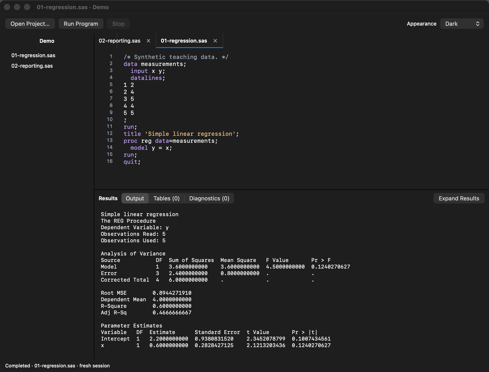

# LocalStat

[](https://github.com/hafiz122/localstat/actions/workflows/ci.yml)

<p align="center">
  
</p>

A native AppKit editor that runs a local ARM64 SAS-language interpreter. The runtime is an extended, pinned copy of [OpenSAS](https://github.com/kirha-ai/opensas), not SAS Institute's engine.

<p align="center">
  
</p>

## Project status

LocalStat `0.1.0-alpha` is a public developer preview for Apple Silicon Macs. It is not a full SAS implementation. The app is ad-hoc signed and not notarized. [Download v0.1.0-alpha](https://github.com/hafiz122/localstat/releases/tag/v0.1.0-alpha) and see [installation and known issues](docs/INSTALL.md).

| Area | Current status |
| --- | --- |
| Native IDE | Editor tabs, project sidebar, syntax highlighting, line numbers, auto-indentation, bracket pairing, file operations, Run/Stop, diagnostics, output, raw-text export and paginated PDF report export are implemented. |
| Local runtime | The app bundles an ARM64 build of OpenSAS pinned to `927a2fa9f1401e365d975536bd704819ada1f1f4`. Each run starts a fresh local process. |
| Statistical modeling | A bounded numeric ordinary-least-squares subset of `PROC REG` is implemented. |
| Verification | 968 runtime tests, 1,924 corpus programs, 11 end-to-end programs, 27 Swift tests and 13 packaged-runtime checks. See the dated verification record for results. |
| Distribution | Reproducible alpha packaging and prerelease automation are included. The artifact remains ad-hoc signed and unnotarized. |
| Compatibility | Coverage is documented and intentionally limited. No feature is labeled SAS-verified without output from an installed SAS engine. |

## Build and run

Requires an Apple Silicon Mac, macOS 14 or newer, Xcode with its command-line tools selected, and network access for the first compiler download. The build pins Zig 0.16.0 and verifies the release SHA-256. Swift is supplied by Xcode. Once built, the app runs offline without a developer toolchain.

```sh
./scripts/build.sh
open 'dist/LocalStat.app'
```

The app is ad-hoc signed for local use. It is not Developer ID signed or notarized. Both executables are ARM64; there is no VM, translation service, Python backend, or hosted SAS dependency.

## Build an alpha artifact

The release-candidate command requires a clean Git working tree, runs the full verification suite, and writes a versioned ZIP plus SHA-256 checksum under `dist/release`:

```sh
./scripts/release-alpha.sh
```

The resulting app uses an ad-hoc signature. Gatekeeper may block it on another Mac because it has no Developer ID signature or notarization ticket. The release workflow creates a draft prerelease. It can be dispatched with a full candidate commit SHA before creating a final tag. It refuses to overwrite an existing release. Do not publish the draft or create the final tag until the release checklist is complete. A candidate verification record is generated at `dist/CANDIDATE_VERIFICATION.md`.

## Use

On first launch, example programs are copied to `~/Library/Application Support/LocalStat/Examples`. Open a project folder to choose the working directory used for relative file paths and `%INCLUDE`. Double-click a `.sas` file in the sidebar or use File > Open Program. File > New Program creates another editor tab.

- Command-S saves; Shift-Command-S saves as another file.
- Command-F opens the native find bar; normal Mac editing/undo shortcuts work.
- Return preserves indentation and adds two spaces after SAS `DATA`, `PROC`, `DO`, and `SELECT` block openings. Tab and Shift-Tab indent or outdent by two spaces.
- Typing `(`, `[`, or `{` inserts its closing bracket. Selections are wrapped, existing closing brackets are skipped, and Backspace removes an empty pair together.
- Command-R runs the **entire current editor buffer**, including unsaved changes.
- Command-period stops the current run, escalating to SIGKILL after two seconds if required.
- Double-click an original-source diagnostic to navigate. Navigation is disabled if its editor buffer has changed, or if the position belongs to macro-expanded text.
- File > Export Last Run as Text saves complete raw output and diagnostics.
- File > Export Report as PDF creates a searchable, paginated report containing the executed source snapshot, run metadata, output, and diagnostics.
- Help > Compatibility and Limitations opens the supported-subset document in a native read-only window.

Every run starts a fresh process: WORK datasets and macro definitions do not persist between submissions. Files explicitly written by your program persist. Output is buffered by OpenSAS until the run finishes, so cancellation may lose that buffered output. Output and diagnostics are kept in memory; very large results require corresponding memory.

SAS programs are executable content. The alpha is not sandboxed: programs can access files allowed to LocalStat and `%SYSGET` can read inherited environment variables. Run only programs and project folders you trust, and do not launch the app from a shell containing sensitive environment variables.

## First modeling feature

```sas
proc reg data=measurements;
  model y = x;
run;
quit;
```

The local extension provides a bounded ordinary-least-squares PROC REG with numeric predictors, an intercept, complete-case filtering, and text estimates/ANOVA. It uses scaled Householder QR with column pivoting. Unsupported procedure options fail visibly. See [the compatibility matrix](docs/COMPATIBILITY.md) for exclusions and numerical edge cases.

## Verify

```sh
./scripts/test.sh
```

This builds the app, runs OpenSAS unit/conformance/end-to-end suites, Swift process integration tests, and packaged-runtime regression checks. Python 3 is only used by the tests, never by the app or runtime. Published example checks have source citations in the test. They are not a claim of new validation against an installed SAS engine.

## Source layout

- `Sources/LocalStat`: AppKit editor, document tabs, project list and result views.
- `Sources/SASCore`: subprocess runner, diagnostic coordinate parsing, and PDF report generation.
- `vendor/opensas`: source snapshot with local changes; `UPSTREAM_COMMIT` records provenance.
- `Tests`: numerical/CLI and Swift integration checks.
- `scripts`: compiler bootstrap, app packaging and verification.

[Runtime changes](docs/RUNTIME_CHANGES.md) distinguish our modifications from upstream. The upstream Apache-2.0 license is retained and bundled with the app. SAS is a trademark of SAS Institute Inc.; this project is independent and unaffiliated.

## Project policy

LocalStat's source code is licensed under [Apache License 2.0](LICENSE). The photographic logo and derived app icon are excluded; see [ASSET_LICENSES.md](ASSET_LICENSES.md). See [CONTRIBUTING.md](CONTRIBUTING.md) before submitting a change and [SECURITY.md](SECURITY.md) for private vulnerability-reporting guidance and the runtime trust boundary. Changes are tracked in [CHANGELOG.md](CHANGELOG.md).

The maintainer runbook is [docs/RELEASE_CHECKLIST.md](docs/RELEASE_CHECKLIST.md). The owner confirmed permission to retain the Patrick Jane logo and authorized public publication on 1 November 2026. The grant reference and attribution remain pending. See [the publication audit](docs/PUBLICATION_AUDIT.md).
