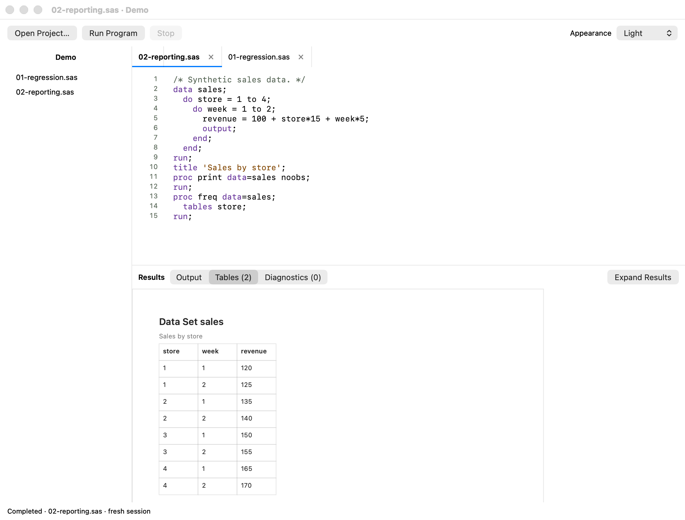
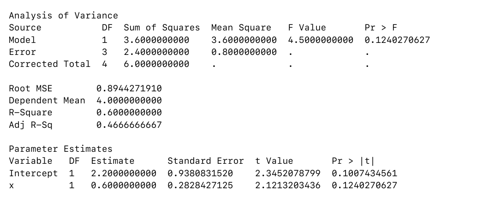

# LocalStat

[](https://github.com/hafiz122/localstat/actions/workflows/ci.yml)

<p align="center">
  
</p>

A native AppKit editor that runs a local ARM64 SAS-language interpreter. The runtime is an extended, pinned copy of [OpenSAS](https://github.com/kirha-ai/opensas), not SAS Institute's engine.

<p align="center">
  
</p>

Source-rendered preview of the committed AppKit views with synthetic regression data. The downloadable alpha has an earlier interface.

## Project status

LocalStat `0.1.0-alpha` is a public developer preview for Apple Silicon Macs. It is not a full SAS implementation. The app is ad-hoc signed and not notarized. [Download v0.1.0-alpha](https://github.com/hafiz122/localstat/releases/tag/v0.1.0-alpha) and see [installation and known issues](docs/INSTALL.md).

Current source builds include a **Tables** results tab for `PROC PRINT`, `PROC FREQ`, and `PROC TABULATE`, closable source tabs, saved Settings, offline Help, and corrected PDF alignment for regression output. The downloadable `0.1.0-alpha` predates these updates.

| Area | Current status |
| --- | --- |
| Native IDE | Horizontally scrolling, closable source tabs, project sidebar, saved viewing and editing settings, five editor themes, separate source/output fonts, offline searchable Help, file operations, Run/Stop, diagnostics, text output, formatted Tables, printing, raw-text export and paginated PDF report export. |
| Local runtime | The app bundles an ARM64 build of OpenSAS pinned to `927a2fa9f1401e365d975536bd704819ada1f1f4`. Each run starts a fresh local process. |
| Statistical modeling | A bounded numeric ordinary-least-squares subset of `PROC REG` is implemented. |
| Verification | Source suite: 969 runtime tests, 1,924 corpus programs, 11 end-to-end programs, 61 Swift tests, 16 packaged-runtime checks, 3 offline Help checks and 1 repository text check. Separate local performance results are described below. |
| Distribution | Alpha automation tests and packages each candidate. New versions produce draft prereleases; repeat runs preserve existing release assets. The app remains ad-hoc signed and unnotarized. |
| Compatibility | Coverage is documented and intentionally limited. No feature is labeled SAS-verified without output from an installed SAS engine. |

<details>
<summary>Formatted tables and PDF output previews</summary>

The light-appearance AppKit preview shows a completed PRINT/FREQ run with eight synthetic sales rows. Both app previews are rendered from source commit `83b46a8` in an isolated process, without accessing a live app session.

<p align="center">
  
</p>

The exported PDF example keeps ANOVA and parameter-estimate columns aligned, with p-values on their original rows. It uses the same synthetic regression data as the editor preview.

<p align="center">
  
</p>

</details>

## Build and run

Requires an Apple Silicon Mac, macOS 14 or newer, Xcode with its command-line tools selected, and network access for the first compiler download. The build pins Zig 0.16.0 and verifies the release SHA-256. Swift is supplied by Xcode; GitHub CI and the alpha workflow pin Xcode 16.2 on macOS 14. Once built, the app runs offline without a developer toolchain.

```sh
./scripts/build.sh
open 'dist/LocalStat.app'
```

The app is ad-hoc signed for local use. It is not Developer ID signed or notarized. Both executables are ARM64; there is no VM, translation service, Python backend, or hosted SAS dependency.

## Build an alpha artifact

The release-candidate command requires a clean Git working tree, runs the full verification suite, and writes a versioned ZIP plus SHA-256 checksum under `dist/release`:

```sh
./scripts/release-alpha.sh
```

The resulting app uses an ad-hoc signature. Gatekeeper may block it on another Mac because it has no Developer ID signature or notarization ticket. A candidate verification record is generated at `dist/CANDIDATE_VERIFICATION.md`.

The alpha workflow accepts a full 40-character candidate commit SHA through manual dispatch, or runs when a matching alpha tag is pushed. It tests and packages the candidate before creating a draft prerelease for a new version. If the release already exists, testing and packaging still run, but duplicate publication is skipped and the existing assets remain unchanged. Complete the [release checklist](docs/RELEASE_CHECKLIST.md) before publishing a new draft.

## Use

On first launch, example programs are copied to `~/Library/Application Support/LocalStat/Examples`. Open a project folder to choose the working directory used for relative file paths and `%INCLUDE`. Double-click a `.sas` file in the sidebar or use File > Open Program. File > New Program creates another editor tab.

- Source tabs scroll horizontally when needed. Click a tab's close button to close that program; Command-W closes the active program. Unsaved changes prompt for Save, Discard Changes, or Cancel; closing another tab preserves the active editor's selection.
- Command-S saves; Shift-Command-S saves as another file.
- Command-F opens the native find bar; normal Mac editing/undo shortcuts work.
- Return preserves indentation and adds the configured indentation width after SAS `DATA`, `PROC`, `DO`, and `SELECT` block openings. Tab and Shift-Tab use the same width: 2, 4, or 8 spaces, with 4 as the default. On upgrade, saved two-space settings switch to four once; later explicit choices are preserved. Existing source text is not reformatted.
- Typing `(`, `[`, or `{` inserts its closing bracket. Selections are wrapped, existing closing brackets are skipped, and Backspace removes an empty pair together.
- Command-R runs the **entire current editor buffer**, including unsaved changes.
- Command-period stops the current run, escalating to SIGKILL after two seconds if required.
- Use the toolbar's Appearance menu to follow the Mac setting or choose Light or Dark. LocalStat remembers the choice between launches.
- LocalStat > Settings (Command-comma) controls editor themes, separate source/output fonts, sizes, wrapping, line spacing, line numbers, whitespace, current-line highlighting, table zoom, and editing assistance. View > Editor Font and View > Output Font open the corresponding font controls directly. View > Increase/Decrease/Reset Size follows the focused content.
- Help > LocalStat Help opens an offline searchable manual and language index. Examples can be copied or opened in a new unsaved editor tab. Command-F finds text in the current article; Command-W closes Help or Settings without closing source.
- Drag the project and results dividers to set pane sizes. View > Hide Project Navigator (Command-0) and View > Expand Results (Command-2) provide keyboard alternatives. Pane sizes and navigator visibility are remembered.
- Double-click an original-source diagnostic to navigate. Navigation is disabled if its editor buffer has changed, or if the position belongs to macro-expanded text.
- File > Export Last Run as Text saves complete raw output and diagnostics.
- File > Export Report as PDF creates a searchable, paginated report containing the executed source snapshot, run metadata, output, and diagnostics. Tabular text, including REG ANOVA and parameter estimates, has aligned columns and fits within the page width. Source text, diagnostics, and raw-text exports retain their original contents.
- The Tables tab shows formatted results for PRINT, FREQ, and TABULATE. File > Print Tables prints all tables from the latest run; PDF reports include the formatted tables and a raw-output appendix.
- Help > Compatibility and Limitations opens the supported-subset document in a native read-only window.

Every run starts a fresh process: WORK datasets and macro definitions do not persist between submissions. Files explicitly written by your program persist. Output is buffered by OpenSAS until the run finishes, so cancellation may lose that buffered output. Output and diagnostics are kept in memory; very large results require corresponding memory.

SAS programs are executable content. The alpha is not sandboxed: programs can access files allowed to LocalStat and `%SYSGET` can read inherited environment variables. Run only programs and project folders you trust, and do not launch the app from a shell containing sensitive environment variables.

## First modeling feature

```sas
proc reg data=measurements;
  model y = x;
run;
quit;
```

The local extension provides a bounded ordinary-least-squares PROC REG with numeric predictors, an intercept, complete-case filtering, and text estimates/ANOVA. REG results use the text Output view; the native Tables view supports PRINT, FREQ, and TABULATE. PDF export aligns REG's ANOVA and parameter-estimate columns, including in raw-output appendices. The solver uses scaled Householder QR with column pivoting. Unsupported procedure options fail visibly. See [the compatibility matrix](docs/COMPATIBILITY.md) for exclusions and numerical edge cases.

## Verify

```sh
./scripts/test.sh
```

This builds the app and runs OpenSAS unit/conformance/end-to-end suites, Swift editor/runtime/PDF integration tests, packaged-runtime regression checks, and Help/text checks. PDF tests inspect exported coordinates to catch misaligned columns, wrapped p-values, and text outside page margins in ordinary reports and raw-output appendices. Python 3 is only used by tests and development tools, never by the app or runtime. Published example checks have source citations in the test. They are not a claim of new validation against an installed SAS engine.

The 5 November 2026 [main CI run](https://github.com/hafiz122/localstat/actions/runs/41939610921) and [alpha validation run](https://github.com/hafiz122/localstat/actions/runs/41939612018) passed for commit `83b46a8`, including packaging, signatures, ARM64 architecture, and checksums. The alpha validation preserved the existing published assets.

The local, unmerged 4 November performance follow-up records 973 runtime tests, 20 benchmark harness/report checks, and opt-in native measurements. These results include optimization changes beyond the verified `main` commit and are separate from its CI totals. Native measurements run only when `LOCALSTAT_BENCHMARK_CONFIG` is set.

## Source layout

- `Sources/LocalStat`: AppKit editor, document tabs, project list and result views.
- `Sources/SASCore`: subprocess runner, diagnostic coordinate parsing, and PDF report generation.
- `vendor/opensas`: source snapshot with local changes; `UPSTREAM_COMMIT` records provenance.
- `Tests`: numerical/CLI and Swift integration checks.
- `scripts`: compiler bootstrap, app packaging and verification.

[Runtime changes](docs/RUNTIME_CHANGES.md) distinguish our modifications from upstream. The upstream Apache-2.0 license is retained and bundled with the app. SAS is a trademark of SAS Institute Inc.; this project is independent and unaffiliated.

## Project policy

LocalStat's source code is licensed under [Apache License 2.0](LICENSE). The photographic logo and derived app icon are excluded; see [ASSET_LICENSES.md](ASSET_LICENSES.md). See [CONTRIBUTING.md](CONTRIBUTING.md) before submitting a change and [SECURITY.md](SECURITY.md) for private vulnerability-reporting guidance and the runtime trust boundary. Changes are tracked in [CHANGELOG.md](CHANGELOG.md).

The maintainer runbook is [docs/RELEASE_CHECKLIST.md](docs/RELEASE_CHECKLIST.md). The owner confirmed permission to retain the Patrick Jane logo and authorized public publication on 1 November 2026. The grant reference and attribution remain pending. See [the publication audit](docs/PUBLICATION_AUDIT.md).
